# 07. Human workflows and proposed screens

Source audit: 2026-10-22. Visual revision: 2026-10-23. Status: proposed interaction design, not a running editor.
The eleven screens below describe the human experience supported by the [native architecture](04-native-architecture.md), [code services](05-code-workspace.md) and [agent/asset contracts](06-agents-and-asset-workflows.md). They are intended for scope review and subsequent prototypes; no interactive usability study or performance validation was performed.

## Visual evidence and interpretation

The revised workspace screens are compact 1920 x 1200 static desktop compositions using Lucide 0.468.0 iconography. Labels, script fragments, settings, layers, selections, job states and change descriptions are illustrative unless explicitly tied to the capture records. A visible control does not establish an implementation, supported API or successful operation. The code sample is not an authoritative UzEngine binding declaration.

Visual revision 5 uses document-driven navigation and neutral gray/black shell surfaces with equal red, green and blue components (`R=G=B`). The footer reads `DESIGN STUDY 05`; manifest revision is 5. Limited semantic colors remain in syntax, axes, warnings, swatches and source imagery; this is not a claim that every pixel is grayscale. Dense controls expose task-specific detail instead of repeating one generic panel layout.

Revision 5 uses runtime captures of Sponza, Materials, DamagedHelmet and character samples: seven runs, eight frames. Character images were produced but shutdown exited 1 with a D3D12MA leak. See [capture provenance](images/README.md) for exact settings and results. No new build, engine correction or matched benchmark was performed.

The same helmet appears in Assets, Generation and Paint intentionally to show continuity of one asset through workspaces. These are not three generated candidates or before/after proof of a paint operation. The VFX particle image is synthetic illustration, not a simulation capture. Diagnostic fields marked `Not measured` are deliberately unavailable; no live FPS, CPU/GPU timing, PSNR or provider cost can be inferred from these compositions.

Source hashes, image dimensions and provenance are recorded in [the image manifest](images/manifest.json). [The contact sheet](images/contact-sheet.png) provides an overview. Image rendering establishes layout intent only; interaction, accessibility, DPI scaling, native child-window behavior and text fit in actual widgets still need acceptance.

## F-029. Existing tools need shared context across human workflows

**Evidence:** The extension registers hierarchy and scene panels at `extension/src/extension.ts:101` and `:111`; its hierarchy is read-only at `extension/src/panels/scene-tree-panel.ts:39`. Native VFX editing has its own composition and undo at `runtime/engine/vfx/editor/vfx_editor_composition.h:70` and `runtime/engine/vfx/editor/undo/vfx_undo_stack.h:38`. These useful implementations do not establish one cross-workspace document/selection/asset transaction model.

**Impact:** A user can lose selection, operate on a stale asset version or misunderstand which scene receives a change when workflows become independent panels. Reproducing every existing surface inside a new shell would not resolve this ownership problem.

**Recommendation:** Share project/worktree identity, document ID and revision, asset ID/version, runtime entity identity and job/session identity across workspaces. Workspace changes alter presentation; they do not silently replace the active project, duplicate mutable state or apply pending edits.

**Confidence:** High for existing scoped tools; medium for the precise future interaction model until tested with artists and developers.

## F-030. Human approval must reflect actual operation and recovery boundaries

**Evidence:** The inspected MCP server exposes documentation tools rather than scene/provider control (`mcp/src/server.ts:44`, `:167`). Chapter 06 identifies missing product-side agent/provider adapters and cooker result/publication gaps at `runtime/tools/uzcook.cpp:683`, `:690` and `:694`. Its Meshy references distinguish local observation from remote cancellation.

**Impact:** A green chat reply, file download or provider completion can be mistaken for a verified, published asset. Ambiguous accept/cancel controls can overwrite human edits, duplicate paid requests or imply a remote operation stopped when it continues.

**Recommendation:** Separate request approval, execution, artifact validation, human review, import and publication. Show affected files/assets and source revisions. Report local cancellation and provider cancellation separately. Every screen must expose recovery from its own failed stage without restarting completed costly work unnecessarily.

**Confidence:** High for the state distinctions and inspected gaps. No provider, DCC or agent workflow was executed for these screens.

## F-031. Visual polish does not establish desktop accessibility or performance

**Evidence:** Current Slate text input explicitly excludes selection, clipboard, IME and multiline at `runtime/engine/ui/slate_editable_text.h:4`; chapter 03 documents clipping and transport limits. These PNGs are static proposals with no input or timing instrumentation.

**Impact:** A polished layout may still fail keyboard operation, screen-reader navigation, mixed-DPI picking or sustained responsiveness. Replacing the viewport transport cannot by itself validate all human interactions.

**Recommendation:** Treat density, focus, keyboard routing, IME, accessible alternatives, docking and physical-pixel coordinates as product requirements. Test representative work at target display scales and under background load before accepting the design.

**Confidence:** High for the evidence limitation and primitive gaps; usability outcomes remain unverified.

## Shared interaction contract

| Context | Shared authority and expected behavior |
|---|---|
| Project and worktree | Always identifiable; changing workspace preserves them; external/agent worktrees remain explicit |
| Document and revision | Dirty, saved, conflict and recovery state survive panel changes; mutations check expected revision |
| Scene selection | Entity identity includes runtime/session validity; selection can open its script or referenced asset without losing scene context |
| Asset and version | Asset Lab, Generate and Paint resolve the same stable identity and approved version; candidate artifacts remain distinct |
| Job and provider task | Local durable job ID survives panels/restart; remote ID and current provider state remain inspectable |
| Agent session and turn | Review shows exact provider, scope, base revisions, permission request and output artifacts |
| Undo transaction | Preview gestures commit meaningful edits; code, scene and VFX histories remain clearly scoped |
| Diagnostics | Identify source tool, target/session, document revision and capture/run provenance |

Do not force one global undo stack across unrelated code, scene and external-provider operations. Show which document receives Undo. Paid submissions and published external effects are not made reversible by putting an undo icon beside them. Preserve a local history and explicit compensating operations where supported.

Use filename/document tabs, a project-aware command/search entry, contextual main area and predictable bottom status. There is no global Scene/Code/VFX/Assets mode bar. The names of screens in this chapter describe editor and panel contexts, not navigation tabs. Keep hierarchy/list tools to the left, selected-object properties to the right, and logs/jobs in an optional bottom dock where this matches the task. The active document, dirty/conflict state and effective runtime capability should remain visible.

Opening `.uzscene` selects its Scene editor; opening C++/Python/Lua source selects Code; material, rig, animation and VFX documents select their corresponding registered editors. Tabs show actual filenames or explicit document titles. Layout and context derive from document type and saved view state. Asset browsing, agent review, Meshy requests/jobs and Paint integration are docks, panels or contextual actions rather than global modes. Opening a panel must not replace the active document or discard its selection/undo state.

A Scene editor may offer Visual and Linked code views only through an explicit source association. The source has its own identity/revision and opens in the code editor. This does not promise scene-to-C++ generation, imply every scene has C++, or equate scene serialization with executable code. Missing/ambiguous links need clear selection/setup behavior. Acceptance must cover file-type dispatch, tab restoration, independent dirty documents and return from linked code to the same scene selection.

Dock panels with sensible minimum widths, restore layouts by version, and offer a reset layout command. If a saved floating panel belongs to a removed monitor, move it to a visible display. At small window sizes collapse optional panels into tabs; do not reduce labels until unreadable. The initial prototype still has one live runtime viewport, even if later concepts include previews in several workspaces.

Text, icons, row heights and column widths need tested scaling rather than raster enlargement. Provide visible focus, semantic labels, keyboard context menus, editable numeric values alongside sliders, discoverable tooltips and non-color-only error states. Dense lists should virtualize and preserve selection while filtering. Support screen-reader access to essential graph/viewport selection through native hierarchy/property alternatives.

Keyboard routing follows focus: typing and IME composition belong to the code/input widget; viewport movement belongs to the focused viewport. Global commands need explicit precedence. Clear pressed input on focus loss and recover after queue overflow. Docking, popups and WebView2/native HWND boundaries require mixed-DPI and multi-monitor tests, including negative desktop coordinates.

## Screen 01: Scene workspace

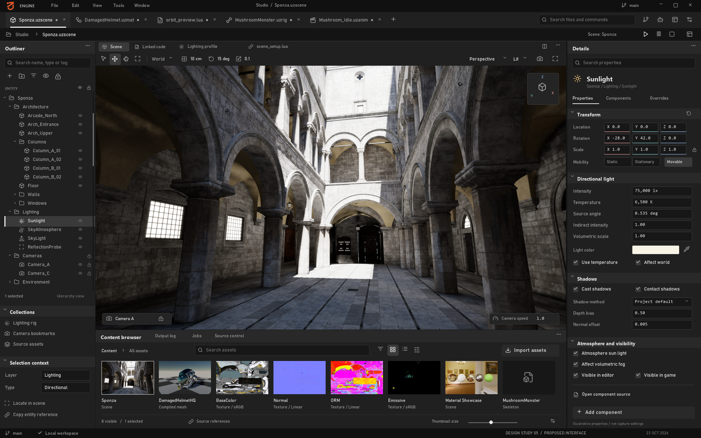

**Human objective:** Select scene objects, understand their properties and see the consequence of a deliberate edit without leaving spatial context.

**Layout:** Expanded outliner selects `Sunlight`; Details exposes Transform, Directional light, Shadows and Atmosphere/visibility sections beside the captured scene. Property values are illustrative, not capture settings. No fabricated object-transform gizmo is composited onto the scene; camera/orientation controls are proposed chrome. The bottom content browser shows scene, mesh, texture and buffer sources with search and view controls.

**Happy path:** Open a scene, select an object in hierarchy or viewport, inspect the same selection, change a numeric property or manipulate its gizmo, commit one undoable edit, then save. Open the selected object's script or material through a typed reference, preserving scene selection for return. Play mode must visibly distinguish runtime changes from authoring changes.

**Errors and recovery:** Missing assets produce identifiable unresolved references, not silent replacement. A stale/deleted entity invalidates selection cleanly. Failed scene save preserves dirty state. Failed load must preserve the last usable document where the loader contract supports it; unsupported hierarchy roundtrip must be disclosed before claiming safe save. Device failure offers diagnostics and document recovery separately from scene success.

**Reuse and missing work:** Reuse runtime rendering, selection/input, component properties, current scene loading and native editor primitives. Add editable hierarchy workflows, coherent inspector adapters, document revisions, transaction/undo integration and tested hierarchy persistence. Current save flattening identified in chapter 02 must not be hidden by an expandable tree UI.

**Acceptance:** Select the same entity through both surfaces; undo a drag as one operation; save/reopen a representative hierarchy without unintended loss; switch to Code and back with selection intact; verify physical-pixel picking after monitor/DPI changes. Measure frame and input latency under inspector edits rather than infer responsiveness from the image.

## Screen 02: Code workspace

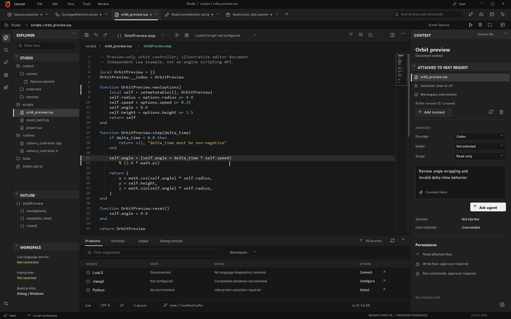

**Human objective:** Edit the code relevant to an object or task while retaining project, build and runtime context.

**Layout:** A dominant code editor with compact file/symbol navigation, document tabs, contextual information and Problems/Output/Terminal tools. Agent context remains subordinate to reading and editing code. Lua, Python and C++ communicate intended language coverage; the image does not demonstrate language servers or a native IDE. The code remains a web library embedded in the native shell.

The document is `orbit_preview.lua`: a standalone `OrbitPreview` Lua example with constructor, step and reset methods, not an engine API demonstration. Explorer, outline, line numbers, minimap and buffer revision are proposed editor surfaces. LuaLS is disconnected, clangd is unconfigured, Python lacks an environment, and the agent request has not started; these states avoid implying working language services or a provider session.

**Happy path:** Open a script from scene selection, edit, receive version-matched diagnostics, save through DocumentService and invoke a supported run/reload action. For C++, choose the actual build target, build and launch with matching symbols. For Python, choose interpreter/venv, run a tool and review outputs. For Lua, use LuaJIT-compatible completion and explicit runtime diagnostics/reload semantics.

**Errors and recovery:** Conflicting external/agent edits open comparison rather than overwrite an unsaved buffer. Missing compiler database, interpreter or language server is an actionable environment state. Build failure does not mark a target runnable as if rebuilt. Unsupported Lua debugger/reload operations remain unavailable. Browser restart restores accepted/checkpointed edits within the documented recovery window.

**Reuse and missing work:** Retain the existing VSCode companion and runtime Lua APIs. Add the embedded host, document authority, clangd/Pyright/LuaLS supervisors, generated Lua API metadata and independent DAP integrations. Debugging the editor process itself uses an external debugger when stopping its threads would freeze the embedded UI. C++ hot reload is not implied by a DLL target.

**Acceptance:** Verify completion against real environments, build/debug each supported target type, preserve dirty documents across workspace changes, test IME and shortcuts without moving the scene camera, and resolve a real concurrent-edit conflict. A separate debug target must pause while the editor remains responsive. Chapter 05 defines detailed recovery and language-service gates.

## Screen 03: Agent review

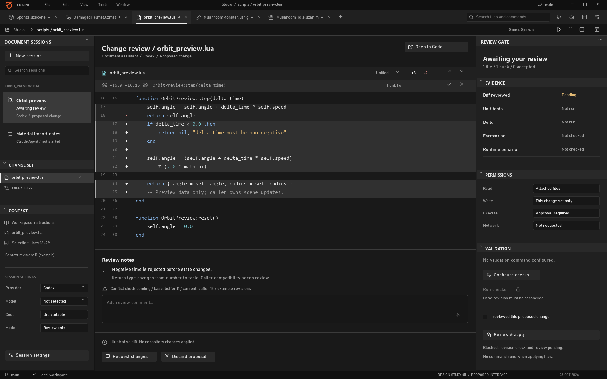

**Human objective:** Understand what an agent proposes, which resources it may touch and what evidence supports applying its output.

**Layout:** Sessions on the left, file/asset changes and validation in the center, permissions/scope on the right. Keep conversation available but do not make prose the only representation of actions. The illustrated diff and session names are fictional; no Claude or Codex task was run to produce them. `Not run` and `Not checked` remain distinct from failed and passed validation.

Revision 5 reviews an illustrative `OrbitPreview:step` change. Its return-type change requires caller compatibility review; example base/current buffer revisions differ. Apply remains blocked on revision reconciliation and human review, checks are unconfigured, and applying files does not authorize running commands. The example is a proposed diff, not a patch executed against the Code screen or repository.

**Happy path:** Start a scoped task with selected files/entities/assets, inspect provider-specific permissions, observe structured progress, review changed artifacts against their base revisions, run relevant checks and apply the chosen change transaction. Keep approved scope and actual effects visible. Use Codex/Claude adapters with explicit session IDs and supported protocols, as proposed in chapter 06.

**Errors and recovery:** A pending approval pauses the dependent action without losing unrelated progress. Provider disconnect retains the durable session record. Cancel/interrupt requests report their actual outcome. A changed target revision triggers conflict review. Failed tests stay attached to the proposed patch. Rejecting a proposal preserves human edits; it is not an instruction to reset the entire worktree.

**Reuse and missing work:** Reuse documentation MCP retrieval and existing project engineering rules as inputs. Add actual product-side session adapters, permission handling, scope tracking, artifact/diff viewers, version checks and durable recovery. Developer-assistant tools installed on this machine are not evidence that users receive these capabilities in UzEngine.

**Acceptance:** Inspect and apply a narrowly scoped change; reject another without touching unrelated edits; recover a disconnected session; resolve a worktree conflict; verify that displayed test outcomes refer to the reviewed revision. Audit events must distinguish permission approval, patch application and remote publication.

## Screen 04: Asset Lab

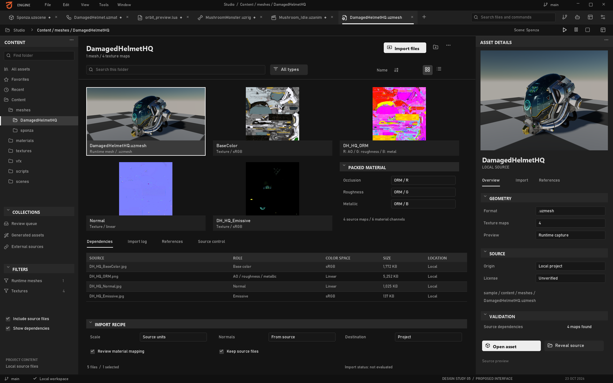

**Human objective:** Decide whether an asset is suitable, trace its source and dependencies, and import or update it without breaking existing references.

**Layout:** Library grid, selected DamagedHelmet runtime preview and actual source-map dependencies beside proposed import controls. This is a static UI around real sample imagery, not a completed import workflow.

Dependencies identify DamagedHelmetHQ.uzmesh and actual BaseColor, Normal, ORM and Emissive maps. Import recipes and validation controls remain proposed; source presence does not establish import acceptance.

**Happy path:** Select an asset, inspect geometry/material metadata, review source rights and dependencies, choose an import recipe, validate/stage outputs, compare against the approved version and publish when checks succeed. Scene insertion uses a stable asset reference, not the currently selected temporary file path.

**Errors and recovery:** Missing textures, unsupported multi-object content, import failure or unresolved rights remain visible. A failed candidate preserves the approved asset. Changed recipe/dependencies invalidate the correct outputs. Disk or manifest publication errors fail the job instead of showing successful import merely because one mesh exists.

**Reuse and missing work:** Reuse glTF/FBX/texture importers, sidecars, compiled formats and VFS. Add asset catalog/version identity, provenance, dependency inspection, transactional publication and scalable native browsing. Chapter 06 records first-mesh importer limitations and cook/cache errors that need resolution before broad production claims.

**Acceptance:** Import mixed assets, compare clean/cached results, change settings and verify invalidation, interrupt publication and recover the prior version, then locate the same asset from a scene reference. Test large libraries and thumbnail jobs without starving the viewport.

## Screen 05: Model generation

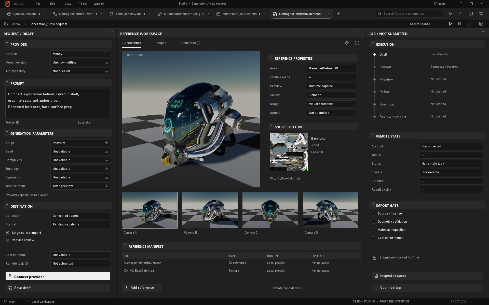

**Human objective:** Turn a request into reviewable candidates while controlling cost, source rights and publication.

**Layout:** Offline request, four runtime camera views of the same DamagedHelmet reference, and an unsubmitted job. Zero remote candidates, unavailable capabilities/cost and no upload distinguish reference inspection from generation.

**Happy path:** Choose an available provider/model, supply permitted references, review supported options and cost information, approve submission, persist the remote task, download completed artifacts, approve shape before refinement where supported, validate locally and stage into Asset Lab. Publication is a separate decision from generation completion.

**Errors and recovery:** Preserve the durable task after timeout or editor restart; reconcile uncertain submission before retrying paid work. Handle quota, authentication, provider failure and expired URLs distinctly. Download results within provider retention limits. Stopping local observation does not cancel remote generation; expose remote cancellation/deletion only when the provider state and API support it. Meshy's in-progress deletion limitation is documented in chapter 06.

**Reuse and missing work:** Reuse downstream import formats and validation primitives. Add provider adapters, capability catalogs, credential storage, durable submission/reconciliation, download validation, provenance and review UI. External model-generation tools mentioned by the owner need their own source/API audit before claiming integration.

**Acceptance:** Recover a submitted task after restart without duplicate billing, distinguish local/remote cancellation, detect malformed downloads, show supported parameters per model and move one approved artifact into Asset Lab with intact provenance. Unavailable cost must remain unknown, not display a fabricated zero.

## Screen 06: Paint roundtrip

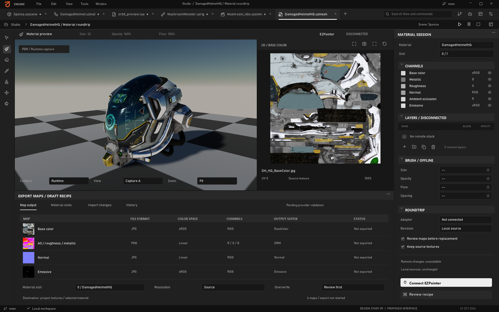

**Human objective:** Refine an asset's materials in the appropriate painting tool and bring back a verified version with correct channel interpretation.

**Layout:** DamagedHelmet runtime image and actual source textures beside a draft export recipe. Remote layers and brush settings remain disconnected; no painting, UV editing or export was performed.

The map recipe uses BaseColor, Normal, ORM (R=occlusion, G=roughness, B=metallic) and Emissive. Sample emissive setting is 5. Existing runtime imagery was not produced by this draft recipe or an external painting session.

**Happy path:** Select a specific approved asset/version, send a roundtrip package to an audited EZPainter/Blender/Substance adapter, edit in the supported external tool, export using the agreed PBR preset, validate returned textures and preview the candidate before publication. Preserve the editable DCC source with the returned version.

**Errors and recovery:** Tool absence or adapter mismatch offers an explicit manual export/import path where supported. Partial export remains incomplete. Wrong normal convention, color space, channel packing, material-slot identity or source version blocks automatic replacement. A concurrent asset change requests comparison. Cancelling local import does not imply the external painting document was closed or discarded.

**Reuse and missing work:** Reuse texture import, material/resource handling and mesh interchange. Audit EZPainter's actual layers, APIs and export support; add versioned DCC adapters, readiness detection, explicit completion status and artifact validation. The proposed native shell does not require embedding another application's entire window as its first integration.

**Acceptance:** Complete one real edit/export/return with matching asset ID and source version, verify normal/channel/color-space correctness in-engine, preserve prior approved content after a failed export, and reopen the editable source. Do not count a changed preview image as proof that the full roundtrip succeeded.

## Screen 07: VFX workspace

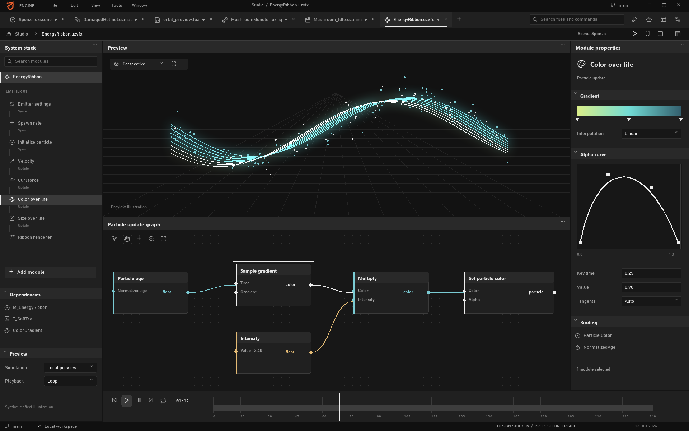

**Human objective:** Understand an effect's behavior, edit a parameter or curve, preview its consequence and save reproducible authoring data.

**Layout:** Emitter/module stack on the left, effect preview in the center, selected curve on the right and graph/timeline region below. The synthetic particle illustration and graph values communicate composition only. A visible timeline does not establish an enabled existing timeline workflow; current composition defaults are documented in chapter 03.

**Happy path:** Open an effect, select an emitter/module, change a parameter or curve with one meaningful undo transaction, preview the supported simulation, inspect diagnostics and save/reopen the effect. Selection must remain synchronized between stack, graph and inspector without creating multiple conflicting documents.

**Errors and recovery:** Unsupported nodes/modules expose capability limits. Invalid graph/compile state preserves the last valid asset while showing actionable errors. Missing assets remain traceable. Undo/redo must not leave graph selection referencing destroyed objects. Preview reset and simulation pause must be explicit; deterministic replay is a capability to verify, not assume.

**Reuse and missing work:** Retain the substantial `VfxEditorOverlay`, curve/graph/parameter widgets, save pipeline and scoped undo. Integrate those models into shared documents/selection and a reviewed shell adapter. Do not replace them with the less complete declarative Slate prototype merely because it has a similar layout.

**Acceptance:** Roundtrip an actual effect, edit/undo/redo graph and curve operations, switch workspaces and restore selection, report a real compile failure and recover the prior valid state. Measure preview under normal authoring load. Every advertised module needs its own functional evidence beyond this illustration.

## Screen 08: Diagnostics and jobs

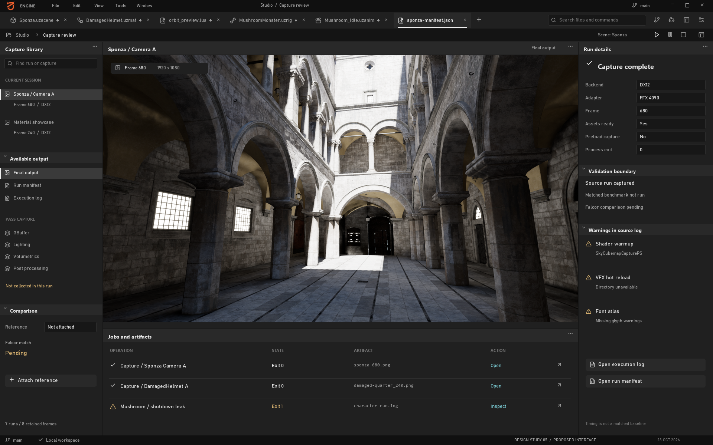

**Human objective:** Diagnose rendering or pipeline failures, understand long-running work and act on evidence without losing authoring context.

**Layout:** Capture navigation, sample runtime images, run evidence and proposed jobs. Character shutdown failed with three D3D12MA allocations totaling 6,881,280 bytes; no engine fix was made. Manifest timing samples are not matched editor benchmarks. See image provenance for individual run outcomes.

**Happy path:** Record a diagnostic run with exact build/scene/settings, inspect available pass outputs, correlate timestamps and errors, then open the associated entity/asset/job. Schedule long imports or reference checks within resource budgets. Resume or retry only a failed stage whose contract supports it.

**Errors and recovery:** Missing capture data does not become zero timing. Unsupported counters remain unavailable. Device loss preserves diagnostic metadata and documents where possible. A failed package write fails the job even if preceding imports completed. Cancelling a job reports whether subprocess/provider work actually stopped and which outputs remain staged.

**Reuse and missing work:** Reuse runtime diagnostic/capture facilities, logging, profiling and import tools. Add durable run/job records, truthful aggregation, provenance links, resource budgets and UI adapters. A successful screenshot run alone does not demonstrate an integrated pass browser or complete performance dashboard.

**Acceptance:** Navigate a real pass dump with correct labels, correlate a failed import to its source and error, restart with durable jobs intact, and measure concurrent work without unbounded UI queues. Compare matched renderer output to Falcor using the project's PSNR acceptance policy; never label an unmatched screenshot as a passing reference comparison.

## Screen 09: Material Graph

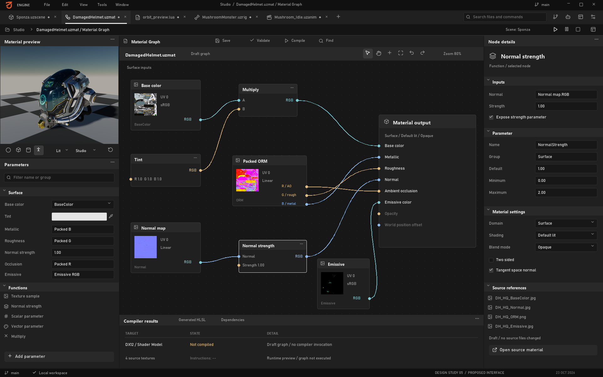

**Human objective:** Understand how material inputs produce a surface, edit a connection or parameter and inspect a validated result before applying it to an asset.

**Layout:** A graph-centered document editor combines a searchable node/parameter surface, selected-node properties, mesh/material preview and compilation diagnostics. The preview uses the same local helmet and source textures as Assets/Paint. Graph connections and exposed values are illustrative; the graph was not compiled and the preview does not show its evaluated output. The neutral gray/black shell follows revision 5.

**Happy path:** Open a specific material asset/version from a scene or Asset Lab, inspect its dependencies, edit a typed input or parameter, validate the graph, compile for a selected supported domain/target, inspect diagnostics and compare the compiled preview before saving/applying. Group a drag or parameter gesture into one undo transaction. Preserve the selected asset and slot when returning to the scene.

**Errors and recovery:** Reject invalid pin types and unsupported connections without damaging the graph. Cycles, missing textures, unavailable nodes and compiler errors must identify the offending node/input. Cancel or supersede stale compile requests; an older result must not replace a newer document. Keep the last successful compiled material available, clearly labeled as stale when edits have not compiled. Failed publication leaves the approved material intact and the document dirty.

**Contract:** Persist graph/node/pin identities, material asset and slot IDs, document revision, dependency versions, domain and compile target. A compile result carries the exact input revision and diagnostics; renderer installation occurs on its owner thread at a valid resource boundary. Distinguish graph save, successful shader compilation and runtime application. Texture roles/color spaces must agree with the import recipe; the screenshot is not a supported-node catalog.

**Reuse and missing work:** Reuse material graph persistence, expression translation and compilation/pipeline infrastructure listed in chapter 02. Add a supported node/domain matrix, human graph interactions, accessible list/property alternatives, document transactions and a revision-safe compile/preview adapter. This request adds a static design, not that implementation.

**Acceptance:** Save/reopen an actual graph with stable links, reject an invalid connection, locate a real compiler error, recover the last valid preview, and prevent out-of-order compile results from applying. Verify material slots, texture channels and scene references after publication. Measure compile responsiveness and preview cost independently; no measured result is supplied here.

## Screen 10: Control Rig

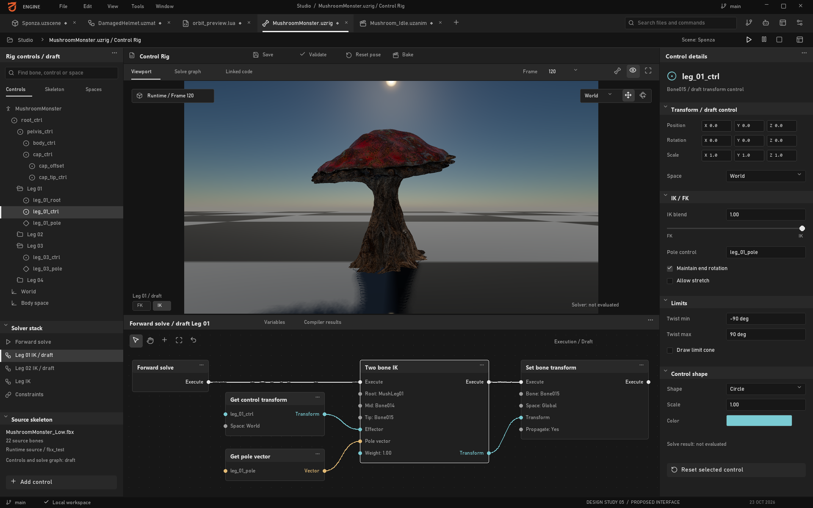

**Human objective:** Define and inspect a character's controllable structure, relationships and constraints before using the rig to author motion.

**Layout:** Character runtime preview and skeleton/control tools for the draft MushroomMonster.uzrig document. The sample has 22 bones. Rig graph, IK/FK controls and solver settings are proposals, not evaluated rig output; the runtime capture does not certify them.

**Happy path:** Bind a rig document to a specific skeleton/version, inspect bone hierarchy and rest transforms, create a control with an explicit space, assign limits/constraints and validate dependencies. Evaluate only supported solvers in a separate preview state, compare against rest pose, then save the rig and hand it to Animation Editor through stable identities. Pose edits must not silently modify the skeleton's bind/rest data.

**Errors and recovery:** Detect missing or renamed bones, incompatible skeleton versions, dependency cycles, invalid transforms and unsupported solver types. An unreachable target or singular configuration requires a defined result and diagnostic instead of corrupted transforms. Failed evaluation preserves the last valid preview; reset restores the documented rest/reference pose. Reimport that changes hierarchy must request remapping rather than bind controls by stale array indices.

**Contract:** Separate skeleton/bind data, rig definition, control values and evaluated pose. Record bone/control IDs, parent relationships, local/world/control spaces, unit and axis conventions, evaluation order and solver capabilities. IK/FK switching needs an explicit pose-matching policy; constraints need limits and failure semantics. Rig undo changes authoring data, while preview evaluation must remain reproducible and isolated from the live scene until applied.

**Reuse and missing work:** Reuse skeleton formats, pose data, animation evaluation and skinning foundations described in chapter 02. A general Control Rig graph, control authoring, IK/FK solvers, constraints, retargeting and baking are separate capabilities requiring source reconciliation and implementation/acceptance; the presence of a sample skeleton does not establish any of them. No such native feature was added for this image.

**Acceptance:** Roundtrip a rig against a real skeleton, preserve rest/bind transforms, verify coordinate conversion and identity after reimport, and test each implemented solver with reachable, unreachable and singular targets. Validate IK/FK matching and undo only when those capabilities exist. Test picking and hierarchy access at multiple DPI scales, and profile the actual mesh/rig workload before choosing preview LOD policy.

## Screen 11: Animation Editor

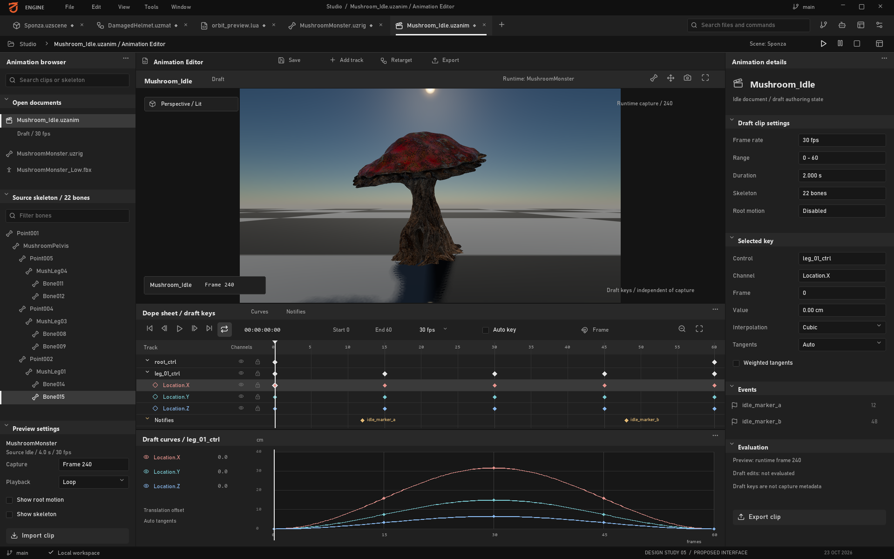

**Human objective:** Inspect timing, pose changes and interpolation, author a clip against a known skeleton, and verify the saved result before runtime use.

**Layout:** The draft UI document `Mushroom_Idle.uzanim` references the real four-second, 30-fps source `animations/AS_Mushroom_Idle.uzanim`, played through runtime controller alias `Mushroom_Idle`. Its runtime preview appears beside proposed tracks and curves. Displayed keys/markers are not extracted from the clip. Runtime capture frames 120/240 are not asserted to be clip key indices. No authoring or baking acceptance is claimed.

**Happy path:** Create/open a clip with an explicit skeleton/version and time basis, select a bone or supported rig control, author keys, inspect interpolation and scrub the evaluated pose. Compare edited and saved versions, validate duration/channel compatibility, then save/publish the clip. Baking a rig into skeletal tracks is a separate supported operation with explicit sampling and error tolerance, not an implied side effect of Save.

**Errors and recovery:** Skeleton mismatch, unsupported channels, missing source clips or invalid time ranges block the affected operation. Preserve dirty keys and recoverable history after failure. Do not report playing when evaluation is unavailable. Handle out-of-range times, duplicate-time keys, zero-duration clips and changed sampling rates explicitly. Source reimport must not overwrite authored tracks without a revision-aware review.

**Contract:** Persist clip ID/revision, skeleton identity, channel targets, time units/frame-rate convention, duration, interpolation and key values. Define quaternion rotation continuity and normalization, looping boundaries and whether root motion is retained in the root track or extracted. Preview pose, runtime controller state and source bind pose remain separate. Event markers, additive layers, retargeting and rig baking appear as capabilities only after their own contracts and tests exist.

**Reuse and missing work:** Reuse skeleton/clip formats, sampling, controller/crossfade and GPU skinning foundations from chapter 02. Add the document/timeline/curve authoring model, key transactions, versioned preview evaluation, validation and publication adapters. Control Rig integration depends on actual rig evaluation; a static timeline cannot certify that dependency or complete animation-tool parity.

**Acceptance:** Save/reopen a real clip, evaluate known keys and interpolated times, test rotation/loop boundaries and verify skeleton identity. Undo grouped key moves, recover unsaved edits, detect incompatible reimport and confirm runtime playback of the published artifact. Separately test baking, root motion and events when implemented. Runtime preview does not establish authoring, baking or motion acceptance.

## Secondary screens without additional mockups

| Surface | Human purpose | Required design boundary |
|---|---|---|
| Project/setup | Open/create project, resolve engine/toolchain versions and missing dependencies | Explicit project root, build profile, interpreter and recoverable validation errors |
| Build/publish | Choose target, validate content, inspect packaging/provenance failures and produce artifacts | Real exit codes, reproducible inputs and dependency closure; publish distinct from build |
| Settings/connections | Configure shortcuts, themes, accessibility, providers and DCC adapters | Secret references rather than plaintext credentials; capability/readiness checks |
| Recovery/conflicts | Restore documents, resolve disk/agent changes and inspect interrupted publication | Show base/current/proposed revisions and preserve unselected human work |

These are secondary requirements, not additional delivered screenshots. Prioritize the first coherent Scene-to-Code-to-Review workflow, then Asset-to-Generation/Paint-to-Publish, while retaining VFX authoring investment. The execution plan must reconcile this sequence with current stabilization priorities rather than treating every mockup as an immediately implementable feature.

## Human acceptance study

Recruit representative engine programmers, technical artists and content artists for task-based sessions. Ask them to perform concrete work without narrator guidance: locate and edit a selected object's script, diagnose a failed import, review an agent patch, recover a dirty document and roundtrip a material. Record success, errors, time, recovery steps and misunderstood states; avoid relying only on aesthetic preference ratings.

Run keyboard-only and assistive-technology sessions, mixed-DPI monitors, narrow windows, large scene/asset lists and concurrent background work. Test actual native/web/GPU boundaries after implementation. No measured task completion, usability score, accessibility certification or performance result is claimed by this report.
