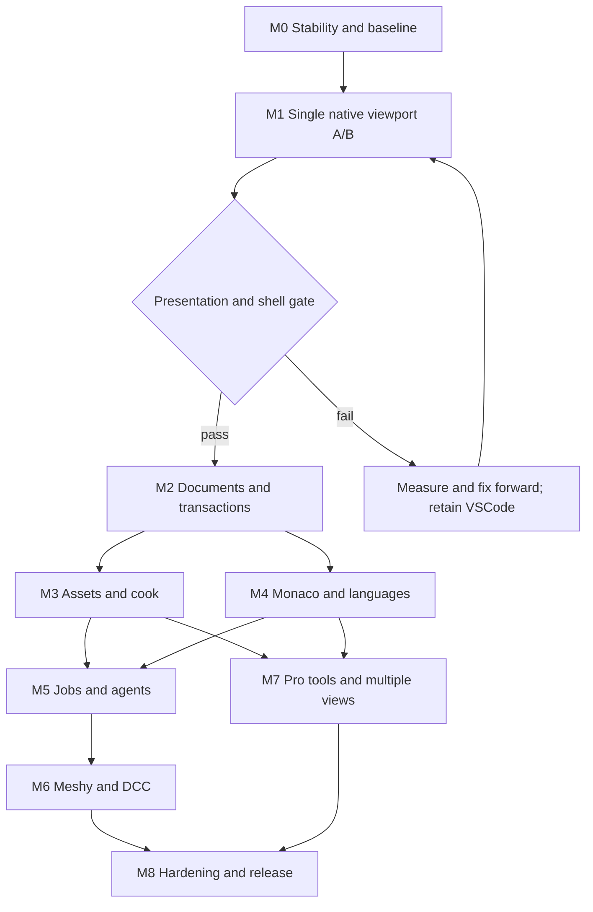

# 09. Proposed execution plan and decision gates

Date: 2026-10-22. Proposed program, not approved schedule or new Rulebook queue. Evidence follows chapters 01, 02, 03 and 06. No benchmark was executed for this plan.

## Objective and boundary

Deliver a responsive Windows authoring application with existing renderer, native presentation, reliable documents, code editing and supervised agent/asset workflows. Keep VSCode usable during migration. Runtime remains in-process in the native host; language servers, agents and DCC tools have independently supervised lifetimes.

First candidate: C++/Qt Widgets, native HWND viewport and lazy WebView2/Monaco. Validate performance and compare cost with completing own Slate framework. Reuse mature VFX behavior without assuming desktop docking, text input and accessibility are complete.

First spike: one viewport, one project. Singleton-style viewport APIs and per-view histories need redesign before multi-view authoring. Four panes in a concept image do not prove four working views.

## Findings register

| ID | Finding | Source | Impact | Confidence |
|---|---|---|---|---|
| F-032 | Prove presentation benefit before replacing shell | Chapter 03 F-009 to F-011; `runtime/engine/app/runtime.cpp:741` | Full rewrite could miss dominant delay | High for transport; benefit unmeasured |
| F-033 | Documents/hierarchy/assets precede reliable automation | Chapter 02 persistence inventory; `runtime/engine/ecs/loaders/scene_loader.cpp:1442`; chapter 06 F-025 to F-027 | Controls can lose hierarchy or overwrite conflicts | High for inspected gaps; architecture proposed |
| F-034 | Single viewport is not multi-window desktop readiness | `extension/src/panels/scene-editor-provider.ts:256`; `runtime/engine/ui/slate_editable_text.h:4` | Histories, DPI, focus, IME and accessibility expand scope | High for limits; effort uncertain |
| F-035 | Provider/agent work needs durable recovery beyond chat | Chapter 06 contracts/acceptance; chapter 01 evidence policy | Ambiguous submissions can lose artifacts or duplicate paid work | High for contracts; EZPainter unverified |

## Dependency graph

Windows stabilization remains controlling priority. Read `.rulebook/PRIORITIES.md` before scheduling; reconcile later closure evidence against stale unchecked work. This graph does not override P0/P1.

## Staffing and estimates

Person-weeks, not calendar commitments. Assumptions: two experienced C++/render/editor engineers, one UI/code-integration engineer, part-time QA/design; reusable Windows toolchain/renderer; one platform; focused tests/docs included. Unrelated engine completion excluded.

| Milestone | Deliverable | Person-weeks | Uncertainty |
|---|---|---:|---|
| M0 | Reproducible baseline | 1-3 | Existing failures |
| M1 | Single-view native spike | 2-5 | HWND/threads/toolchain |
| M2 | Documents and persistence | 5-10 | Identity/hierarchy/recovery |
| M3 | Assets and incremental cook | 4-9 | Dependencies/publication |
| M4 | Monaco, LSP and debugging | 5-11 | Environments/adapters |
| M5 | Jobs and agent review | 5-10 | Protocol/auth/conflicts |
| M6 | Meshy and DCC roundtrip | 5-12 | EZPainter/interchange |
| M7 | Pro tools and multiple views | 7-16 | Histories/accessibility |
| M8 | Hardening and release | 4-9 | Real-project failures |

Total arithmetic: 38-85 person-weeks for this bounded program, not the whole engine. Dependencies/specialist ownership prevent dividing mechanically by headcount. M0+M1 is 3-8 person-weeks of evidence investment; a spike is not a polished product. Re-estimate after M1, M3 and EZPainter audit. A new painting engine, arbitrary VSCode extensions or platform parity requires separate scope.

## Milestones and exits

### M0. Trustworthy baseline

Entry: current priority scope and owners identified. Produce a manifest with commit plus working-tree diff identity, compiler/Zig, build mode, SDKs, GPU/driver, CPU/RAM, OS, monitors/refresh/DPI, power profile, backend, scene hashes, camera path, cvars, assets and physical output resolution. Separate existing failures from migration regressions.

Workloads: empty scene, representative production scene, heavy VFX and material/asset-heavy scene. Run identical content in standalone and extension wherever compatible; disclose differences. Unstable scenes become stabilization inputs, not silently excluded samples.

Exit: another engineer reproduces loading, capture and interpretation. Required stability checks pass, or an explicit owning gate blocks dependent rollout. Historical task counts are not performance evidence.

### M1. Single native viewport feasibility

Entry: M0 workloads. Build one host, in-process engine, explicit viewport target and one swapchain/Present owner. Disable ordinary viewport readback/encoding through explicit capability/configuration, preserving capture infrastructure. Verify absence of capture work in traces; a non-null parent HWND alone does not prove capture is disabled.

Qt uses its GUI thread. WebView2 is created/accessed on its STA thread with a message pump. Media Foundation MTA work belongs on a suitable separate thread; never change an initialized COM apartment to satisfy another subsystem. Define HWND creation/destruction and message-pump ownership. Render cadence stays independent from DOM repaint and language services.

Add lazy Monaco after baseline measurement. Validate resize, hide/show, minimize, close and focus transfer. Compare shell capability/cost with completing Slate, retaining specialized VFX overlays.

Exit: measured presentation passes proposed budgets and lifecycle checks below. If GPU work dominates, optimize measured passes without claiming shell solved them. If composition/lifecycle fails, correct that bounded issue before expanding scope.

### M2. Documents and transaction ownership

Entry: M1 host stable. Add project/document identity, dirty state, save/save-as, autosave/recovery, external conflicts, durable scene identities and transactional commands. Human controls and agents share a validated mutation boundary. Edit and play states remain distinct.

Reconcile scene save flattening. Exercise nested transforms, hierarchy, missing assets, malformed files, duplicate IDs, deletion/undo and save failure. Component deserialization needs transaction semantics; it is not proof of atomic editing.

Exit: save/load preserves scene semantics/hierarchy; failed load/save preserves previous usable document; undo/redo restores state/selection without stale handles. Restart exposes conflicts rather than overwriting newer content. Multi-selection needs acceptance beyond single-entity picking.

### M3. Reproducible assets and cook

Entry: M2 identities/transactions. Add application asset catalog, dependency edges, source/output mappings, versioned recipes and provenance. Reconcile cooker skip/type-preservation gaps from chapter 06. Stage outputs and publish coherently.

Exit: clean and cached mixed-asset cooks produce equivalent logical outputs, types, dependencies and runtime resolution. Changed settings/source/dependencies invalidate correct outputs. Missing companions, interruption and pack/manifest failures remain visible and preserve last usable versions. Require byte equality only where deterministic formats promise it; otherwise compare canonical semantics and explicit tolerances.

### M4. Code documents and services

Entry: M2 model/browser lifecycle. Add stable Monaco URIs/disposal, diagnostics, search, build targets and service supervision. Provide selected C++/Python/Lua LSP/DAP workflows, environment selection and unavailable-capability states. Highlighting alone is incomplete.

Exit: save/conflict recovery works across scene/code documents; C++ follows compile settings; Python uses chosen environment; Lua debugging matches chosen runtime adapter. Service crash/restart, cancellation and stale diagnostics are tested. IME, Unicode, clipboard, keyboard and screen-reader workflows pass. Monaco does not imply arbitrary VSCode extension support.

### M5. Durable jobs and agent review

Entry: M2 conflicts, M3 assets, M4 code. Persist jobs before provider UI. Implement Codex/Claude adapters with documented protocols, scoped sessions, approvals, capabilities and usage. Agent processes never own renderer lifetime.

Exit: restart restores jobs/sessions without silent write replay; approvals resolve once; interrupted operations have truthful status; concurrent human edits trigger conflict handling. Review applies changes by exact file/asset/scene scope. Continuous output/build/import respects interaction budgets. Authentication/distribution matches intended product model.

### M6. Meshy and DCC roundtrip

Entry: jobs/catalog/review. Implement generation, reconciliation, artifact download/validation, shape/refinement approval and import. Audit actual EZPainter API, repository and license before choosing embedding/shared-renderer/external-tool integration. Start with versioned send/edit/receive.

Exit: restart during submission/download/import avoids duplicate paid work and preserves artifacts. Reconcile ambiguous submissions instead of blind retries. Expired URLs, quotas, unsupported cancellation and malformed assets have distinct outcomes. Real supported DCC roundtrip retains asset identity, transforms, slots, channels and dependencies. Unsupported EZPainter behavior becomes explicit scope, not a decorative control.

### M7. Professional tools and multiple views

Entry: M2/M3/M4 stable. Reuse VFX behavior/undo; add inspector/hierarchy, material/VFX tools, profiler/pass inspection and persistent docking. Share models across tabs; capability-gate unvalidated engine features.

Before multiple views, define session/view handles, independent cameras, targets, temporal histories, selection contexts and GPU budgets. Specify shared world versus separate preview world. Validate resize/close and native overlay layering.

Exit: histories/picking are isolated; memory scales predictably; monitor docking preserves DPI/focus/documents; closing one view cannot destroy shared assets/world. Human task tests cover keyboard navigation, discovery and recovery.

### M8. Product hardening and release

Entry: M6/M7 acceptance for advertised capabilities. Run long sessions, clean-machine install, dependency availability, crash recovery, format compatibility and release checks. Publish actual backend/capability limits.

Exit: supported hardware meets agreed budgets; documents/jobs recover after tested failures; install needs no developer paths; projects stay portable. Claims match tested workflows. No engine feature is marked complete merely to release shell.

## Proposed performance acceptance protocol

All thresholds are initial targets to agree/version before measurement, not results. Changes after failures require recorded rationale. Match VSync/tearing, render scale, physical resolution and quality when comparing hosts.

| Dimension | Proposed protocol/target | Interpretation |
|---|---|---|
| Sampling | 30-second warmup; at least three 120-second captures per scene/config; cold start separate | Report variation, not best run |
| Frame time | CPU/GPU p50/p95/p99 and displayed cadence; initial shell increment p95 <= 1 ms, p99 <= 2 ms against native baseline | Proposed budget; report absolute times too |
| 60 Hz scene | p95 <= 16.67 ms, p99 <= 25 ms on agreed scene/reference hardware | Heavy content needs separate GPU targets |
| 120 Hz stretch | p95 <= 8.33 ms on designated light scene | Not promised for all content |
| Input-to-present | Correlate event/frame timestamps; added shell p95 <= one refresh interval | Present return can precede scanout |
| Input-to-photon | High-speed camera/photodiode when physical latency matters | Include display response and uncertainty |
| Competing work | Repeat typing, AI output, build/index, thumbnails and import | Preserve input state and job budgets |
| Hidden/idle | Trace no unwanted capture/render according to idle policy | Report resume latency separately |
| Long run | Four-hour mixed workflow plus 100 document open/close cycles | Compare equal warmed idle checkpoints |
| Memory drift | Final comparable idle process/VRAM <= 5% above first warmed checkpoint; report MB/handles | Investigate monotonic growth; distinguish bounded caches |

Use PresentMon/ETW, existing CPU/GPU profiles and queue counters. Separate rendered, encoded, delivered, decoded and displayed frames. Record frame age/drops. Do not derive physical latency from FPS or sum uncorrelated average stage timings.

Use uncapped monotonic wall-clock samples for hitch/latency statistics: current runtime `frame_ms` uses simulation `dt` that clamps intervals above 100 ms to 16 ms (`runtime/engine/app/runtime.cpp:693`, `:696`, `:812`). Keep the simulation clamp while instrumenting raw timing separately. Distinguish input-to-submit, input-to-present-call and observed displayed-frame timestamps; they are different endpoints and none alone is input-to-photon.

The 5% memory target is an alert threshold for comparable warmed runs, not permission to leak. Acceptance also requires no persistent unreleased documents/models, native handles or GPU allocations across identical open/close cycles. Account for the host and browser/agent/language-server process tree separately; a stable host RSS cannot prove the entire application is stable.

The incremental budget is evaluated with matched workload/configuration and repeated runs, not subtraction of unrelated benchmark averages. Include confidence/variation when deciding whether a small difference is meaningful. Report any renderer setting changed to meet budget as a separate quality configuration.

## Desktop correctness matrix

| Area | Required cases and evidence |
|---|---|
| DPI | 100%, 125%, 150%, 200%; monitor moves both ways; physical dimensions/picking agree |
| Focus/input | Viewport/Monaco/panels, Alt-Tab, modals, capture loss, releases during backlog; no stuck navigation |
| Text | Portuguese accents, non-Latin text, IME commit/cancel, selection, clipboard, undo, assistive navigation |
| Persistence | Hierarchy roundtrip, dirty documents, failed writes, external edits, interrupted save/recovery |
| Assets | Clean/cached equivalence, rename, settings/dependency changes, invalid import/publication failures |
| Jobs | Approval/restart, disconnect, cancel-after-completion, duplicate events, conflicts, ambiguous submission |
| View lifetime | Resize/minimize/hide/close during load/GPU work, device loss, later multi-view close ordering |
| Packaging | Fresh machine, missing browser/runtime, spaces/non-ASCII paths, read-only locations, offline startup |

## Forward-only migration

Keep VSCode usable while adding native host. Feature flags select host/presentation/integration via explicit application/project configuration; runtime stays path-agnostic. Preserve readable formats through versioned additive migrations and recovery. No destructive Git reset/revert belongs to this plan.

M1 go requires reproducible presentation/lifecycle evidence. M3 blocks provider expansion until publication/cache correctness passes. M5 blocks automation rollout if review/permissions can overwrite human work. M7 retains one viewport until per-view state/memory scaling pass. Failed gates produce measured corrections, not enabled unreliable features.

Fallback retains the last accepted selectable path while fixing forward. It does not delete new work or relabel failed benchmarks. Remove duplicate adapters only through a later explicit migration decision.

## Existing Rulebook relationship

| Scope | Relationship |
|---|---|
| `.rulebook/PRIORITIES.md`, `phase0_project-stabilization-audit` | Windows ownership/lifetime/visual prerequisites; reconcile later closure evidence |
| `phase5-5.1.0-editor-visual-tools` | Reuse picking/gizmos; identify remaining acceptance |
| `phase5-5.2.0-vscode-pass-inspector-ui` | Reconcile diagnostic destination; preserve CLI diagnostics |
| `phase5-5.1.0-multi-material-multi-uv` | Asset/DCC correctness; avoid duplicate primitive work |
| `phase3-3.0.0-fbx-skeletal-animation-pipeline` | Reuse formats/import; add actual interchange acceptance |
| Native shell/documents/jobs/adapters | Proposed scope; later bounded tasks require priority/architecture decision |

This chapter creates, reorders or completes no engineering tasks. Report documentation tracking is separate from this proposed program. Each milestone needs source-backed scope, dependencies and acceptance before entering the queue.

The first actionable decision is whether to authorize the bounded M0/M1 evidence spike after reconciling current stabilization scope. Product-wide implementation should follow its results, not a visual concept alone.
