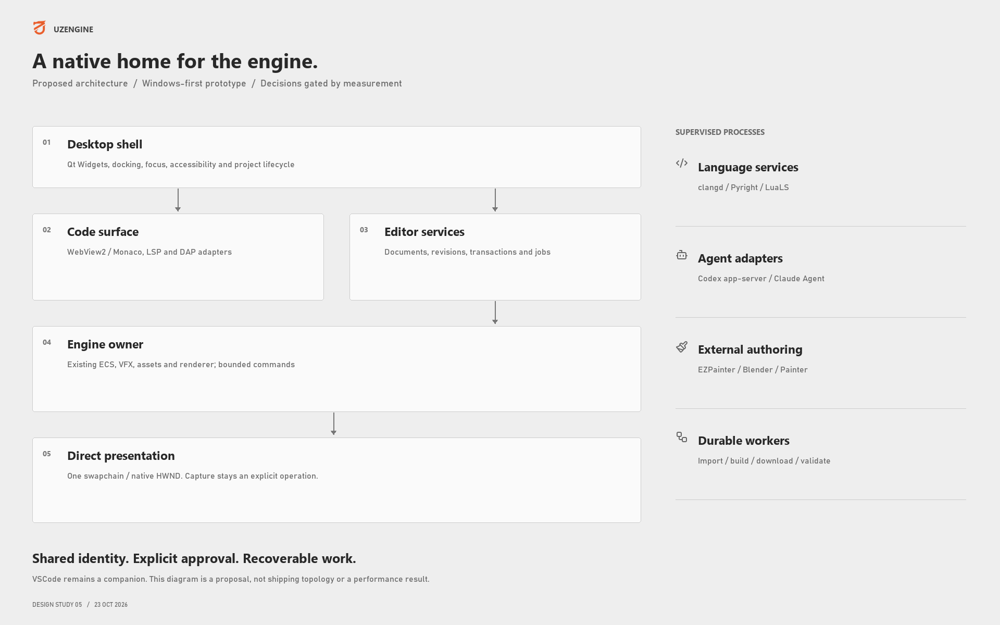
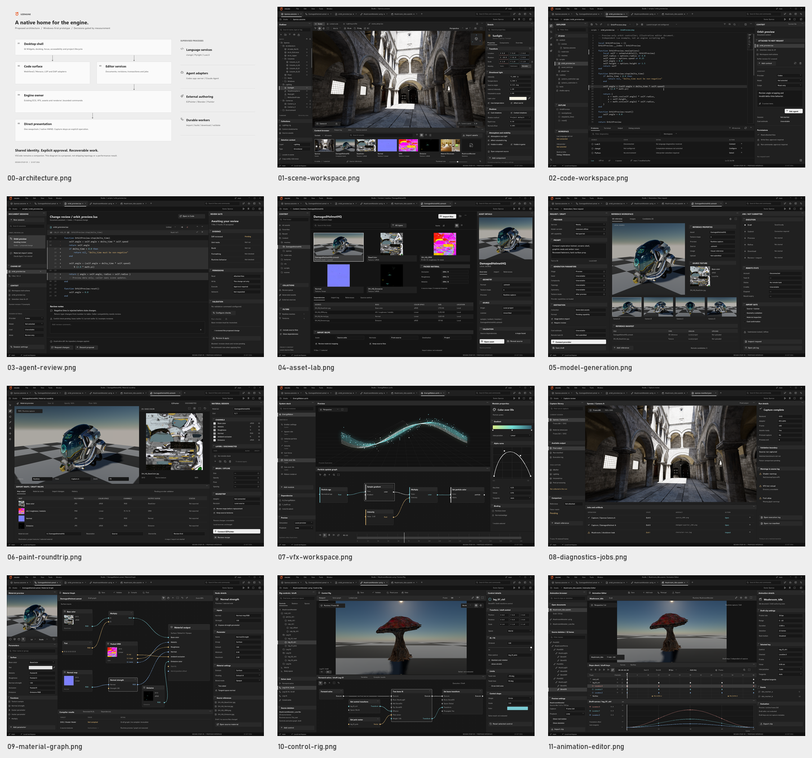

# GUI strategy and project readiness

**UzEngine | Evidence-based audit and native editor proposal | 22 October 2026**

Requested scope: what the project already contains, what remains to implement,
why the current VSCode viewport deserves reassessment, and how a high-performance
human-facing editor could combine scene authoring, Python/C++/Lua, Codex, Claude,
Meshy and EZPainter.

This is an architectural and source survey, not a product implementation or a
new performance certification. Repository documentation is in English.

## Decision in one page

**Build and measure a bounded Windows-native host prototype before committing to
a new editor shell.** First candidate: **Qt Widgets/QDockWidget + direct DX12
presentation in a native HWND + lazy WebView2/Monaco for code and diffs**.
Reuse the engine and existing VFX authoring behavior. Keep VSCode as a companion
and fallback during migration.

The strongest reason is the inspected viewport path, not a general claim that
VSCode or web technology is slow. Current integration renders into a hidden
native window, captures the backbuffer, performs CPU work and H.264 transport,
then decodes into a webview canvas. Direct native presentation can remove those
stages from the local primary viewport. **Their share of total latency and the
resulting speedup have not been measured in this audit.**

A modern editor needs more than a fast viewport. Document identity, undo,
hierarchy persistence, asset dependencies, recovery, language services and job
supervision must become shared application services. Otherwise, a better-looking
shell still exposes incomplete or unsafe production workflows.

The existing custom Slate-style layer remains an alternative to evaluate, not
discard. It already supports meaningful engine-native UI work, but general text
editing, precise clipping and desktop behavior need investment. Its maturity is
different from the much more substantial native VFX overlay.

## Read the report

[Open the offline report and image gallery](index.html). Markdown chapters remain
the source of truth; the HTML is a generated convenience copy.

| Chapter | Question answered |
|---|---|
| [01. Scope and evidence](01-scope-and-evidence.md) | What was inspected, what was not run, and how confidence is stated |
| [02. Engine inventory](02-engine-inventory.md) | Existing implementation and remaining authoring work across 31 capability areas |
| [03. Editor and performance](03-editor-and-performance.md) | Actual VSCode transport, existing safeguards, native UI maturity and measurement needs |
| [04. Native architecture](04-native-architecture.md) | Toolkit tradeoffs, HWND/thread/process ownership, deployment and licensing |
| [05. Code workspace](05-code-workspace.md) | Monaco alternatives, document authority, C++23/Python/Lua, LSP/DAP and recovery |
| [06. Agents and assets](06-agents-and-asset-workflows.md) | Codex/Claude, Meshy/EZPainter/DCC, asset pipeline defects and durable workflows |
| [07. Human workflows and screens](07-human-workflows-and-screens.md) | Screen proposals, user actions, failure states, accessibility and acceptance |
| [08. Gap register](08-gap-register.md) | 45 consolidated gaps with priority, dependencies, effort class and acceptance |
| [09. Execution plan](09-execution-plan.md) | M0-M8, decision gates, provisional budgets, estimates and forward-only migration |

Findings use unique identifiers **F-001 through F-035**. Consolidated work items
use **G-001 through G-045**. They are report identifiers, not newly created
Rulebook tasks. Existing stabilization priorities remain authoritative.

## What the project already has

| Area | Source-backed position | Main limitation for this product |
|---|---|---|
| Renderer and GPU infrastructure | Substantial RHI, render graph, raster/lighting/environment/post-processing and ray-tracing source | Feature presence, integration, backend availability and validated parity are different |
| ECS, scenes and properties | Entities, component metadata, scene I/O and scripting hooks | Durable editing identity, hierarchy round-trip and general transactions remain incomplete |
| VFX authoring | Native overlay, graphs, curves, stack/browser widgets and undo | Integrate existing behavior into shared workspace rather than restart it |
| Animation | Skeletons/clips, controller state transitions, crossfade and GPU skinning | Production interchange, authoring UI and remaining feature acceptance |
| Assets | glTF/FBX, textures, compiled formats, sidecars, cook, manifests, pak/VFS and background loading | Reliable incremental publication, dependencies and artist-level reimport workflow |
| VSCode integration | Worker/N-API bridge, viewport streaming, panels and recovery safeguards | Local viewport still crosses capture/video/webview stages; not a full native editor |
| Diagnostics | CPU/GPU profiling interfaces, captures, pass/pixel diagnostics and extensive test source | Reproducible current benchmarks and complete matched reference acceptance |
| Lua and core runtime | Script lifecycle, many engine APIs, jobs, config, paths and build infrastructure | Code editing/debugging is separate from script execution; Python tool execution is separate from embedding |
| Physics/audio/navigation/gameplay | Interfaces, plans and some consuming systems | Not at renderer/VFX maturity; do not market absent foundations as complete |
| Agent/provider product workflows | Documentation MCP and planned integration surfaces | Live editor agents, Meshy and EZPainter workflows were not established by inspected product code |

The inventory is broad, not a claim of an exhaustive line-by-line correctness
proof. No single percentage meaningfully represents completion of these systems.

## Highest-impact conclusions

1. **Measure the correct path.** The current topology differs from historical
   native-HWND/in-process-extension descriptions. Analyze frame age and
   input-to-present as well as GPU time and FPS.
2. **Do not erase completed stabilization.** Queue limits, keyframe recovery,
   owner-thread handling and fatal scene-input preservation already exist.
   Reconcile older audits with current source and later closure records.
3. **Own editor state before scaling automation.** Scene hierarchy is flattened
   on serialization; VFX undo is not yet a universal document transaction system.
   A native outliner or agent cannot make those contracts reliable by itself.
4. **Fix asset publication before provider expansion.** Static inspection found
   cache-hit type handling, sidecar invalidation/atomicity and publication
   error-reporting gaps. A generated model must survive staging, import and
   restart before a provider button is production-ready.
5. **Use Monaco for its real scope.** It supplies editing, not the VSCode
   extension host. Language servers, compilation databases, interpreter
   selection, debugging, build tasks and shared unsaved documents need explicit
   integration.
6. **Treat agents as supervised tools.** Codex app-server and Claude Agent SDK
   require versioned adapters, approvals, context limits, conflict-aware review
   and process supervision. A terminal or chat panel is not the full workflow.
7. **Make paid/external jobs durable.** Meshy submissions, expiring downloads,
   ambiguous failures and unsupported cancellation require truthful job states.
   EZPainter needs an actual API/license audit before embedding is promised.
8. **Do not promise full Unreal parity.** Reuse Unreal-style workspace concepts
   selectively: docking, outliner, inspector, content browser and specialized
   editors. UzEngine's implementation and product scope remain its own.

## Visual proposals

Eleven workspace screens and one architecture diagram are included. Images are
static design studies, not screenshots of an implemented replacement editor.

Navigation is document-driven: tabs show filenames, and file type selects the
editor/layout (`.uzscene`, C++/Python/Lua, material, rig, animation or VFX).
Scene/Code/Assets/VFX are not global mode tabs. Agents, asset browsing, Meshy jobs
and Paint integrations are contextual docks/panels/actions. Screen names below
describe these contexts. A scene can switch between visual editing and explicitly
linked source code; no automatic scene-to-C++ generation or mandatory scene/C++
association is implied. Each linked document retains its own save/revision state.
Their state is illustrative; no provider jobs were submitted.

| Screen | Human purpose |
|---|---|
| [Scene](images/01-scene-workspace.png) | Compose and inspect scene while viewport remains primary |
| [Code](images/02-code-workspace.png) | Edit scripts/tools/native source with contextual engine information |
| [Agent review](images/03-agent-review.png) | Review changes, approvals and validation before applying |
| [Asset lab](images/04-asset-lab.png) | Inspect source, provenance, dependencies and import state |
| [Model generation](images/05-model-generation.png) | Review request/cost, candidate and staged publication |
| [Painting round-trip](images/06-paint-roundtrip.png) | Preserve asset identity and channel contracts across external painting |
| [VFX](images/07-vfx-workspace.png) | Reuse stack, graph, curve and timeline authoring |
| [Diagnostics and jobs](images/08-diagnostics-jobs.png) | Inspect captures and recover background operations |
| [Material Graph](images/09-material-graph.png) | Author typed material connections and review compile/apply state |
| [Control Rig](images/10-control-rig.png) | Inspect skeleton/control relationships and proposed rig evaluation |
| [Animation Editor](images/11-animation-editor.png) | Author clip timing, keys and curves against a known skeleton |

Revision 5 (2026-10-23) uses real DamagedHelmet sample rendering and actual maps; the material graph remains uncompiled. Control Rig is a `MushroomMonster.uzrig` draft around a runtime character preview. The real source `animations/AS_Mushroom_Idle.uzanim` plays through runtime alias `Mushroom_Idle` on the 22-bone character, with four-second duration at 30 fps. The UI's `Mushroom_Idle.uzanim` is a draft document referencing that source; timeline keys and curves remain illustrative, not extracted. These screens add no native authoring implementation or measured host-performance evidence.

[Visual provenance and reproduction](images/README.md) documents fresh runtime
Sponza, Materials, DamagedHelmet and character captures, run outcomes, synthetic VFX
illustration and hashes. The revised workspace proposals use compact 1920 x 1200
layouts with Lucide iconography; they remain static design studies. Revision 5
uses neutral gray/black shell surfaces (`R=G=B`), retaining color in syntax,
semantic details and source imagery. Navigation is document-driven; the footer
is `DESIGN STUDY 05` and manifest revision is 5. Scene selects illustrative `Sunlight`
properties without adding a fabricated object-transform gizmo to the capture.

Code centers on a standalone `OrbitPreview` Lua example with disconnected language
services; Agent Review shows a separate proposed diff blocked on review/revision
checks. Assets exposes real local dependencies and a draft import recipe.
Generation shows local reference angles and zero remote candidates. Paint shows
source textures, an explicit draft channel map and an empty disconnected layer
stack. None of these controls establishes implemented integrations or measured
editor performance. Capture warnings and provenance remain documented below.
The same helmet appears across asset/generation/painting views to show continuity;
it is not evidence of Meshy output or an EZPainter integration.

## Recommended delivery order

| Stage | Deliverable | Decision |
|---|---|---|
| M0-M1 | Matched baseline and one native viewport; optional lazy code view | Continue only after ownership, presentation and responsiveness pass |
| M2-M3 | Documents, hierarchy, transactions, recovery and reliable assets | Prove data safety before expanding automation |
| M4-M5 | Code services, debugger/process supervision, durable jobs and agent review | Prove language environment and approval/revision semantics |
| M6 | Meshy and supported DCC round-trips | Validate provider contracts and actual EZPainter capabilities |
| M7-M8 | Professional editors, multiple views, accessibility, packaging and hardening | Release only supported, tested capabilities |

Planning estimates: **3-8 person-weeks for M0+M1**, then re-estimate.
The bounded M0-M8 program totals **38-85 person-weeks**, not calendar weeks
and not completion of the entire engine. Chapter 09 states assumptions,
dependencies, uncertainty and exclusions. These are not measured productivity
or an approved schedule.

## Validation status

No new runtime build, native unit suite, live-editor benchmark, GPU debugger
capture or matched Falcor comparison was run. Seven sample runs supply eight published frames: Sponza, Materials, four DamagedHelmet cameras and two character frames from one run. Six runs exited 0. Character images were produced but shutdown exited 1 with three remaining D3D12MA allocations totaling 6,881,280 bytes. No engine fix was made. These are image-production runs, not benchmark or source-build certification; exact records are in the image inventory.

The stabilization record dated **2026-10-17** reports **7,827 native tests:
7,807 passed, 17 skipped, 3 pre-existing VFX failures; exit code 1**.
It is historical evidence, not a current all-green gate. The broader matched
Falcor matrix remains open.

Documentation validation covers report structure, local links, identifier
coverage, image hashes/dimensions and static visual inspection. It does not
validate interactive docking, keyboard input, IME, accessibility, language
services, agent approval behavior or native presentation performance.

Changes cover this report and its reproducible assets, plus the explicitly
authorized replacement of root `.screenshots` with fresh runtime captures.
Existing runtime/math, dependency and reference changes were preserved.
