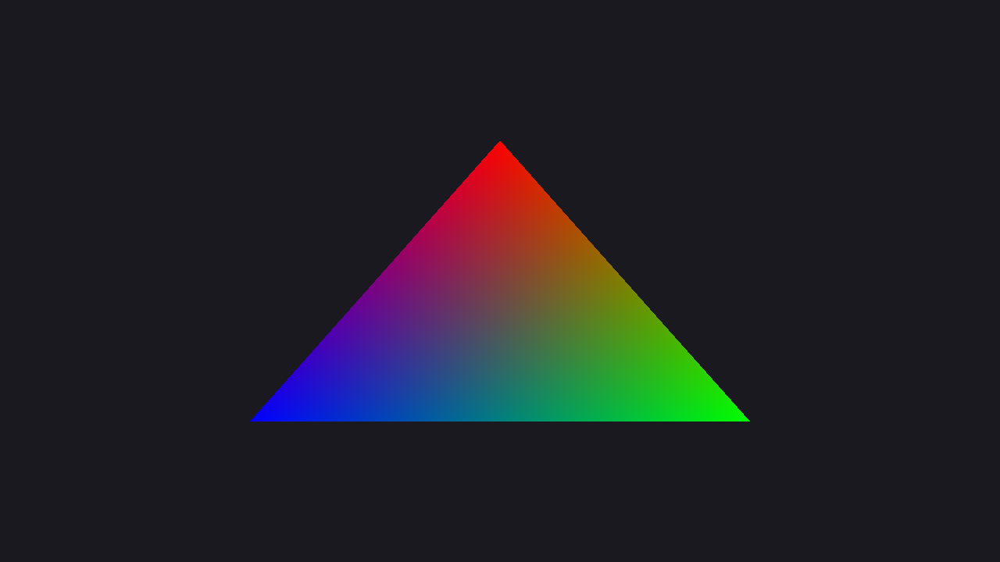
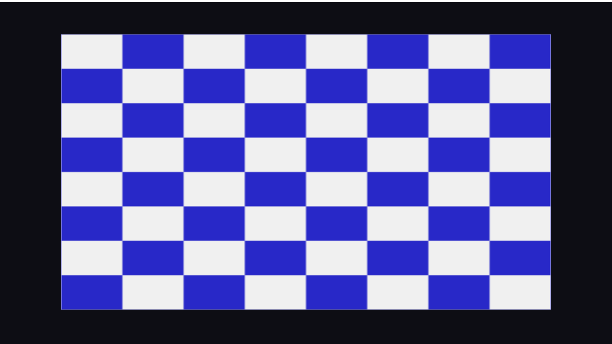
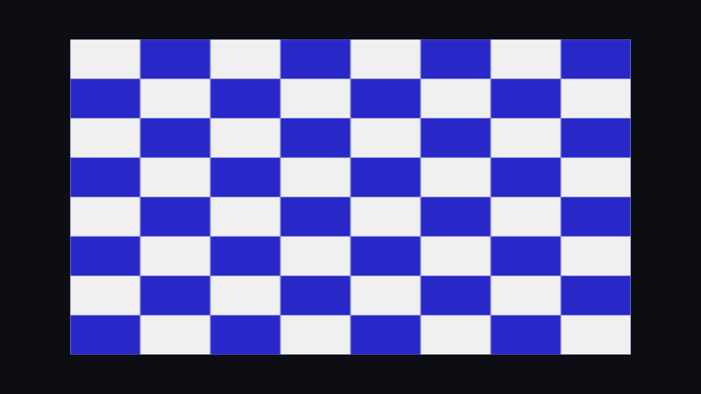
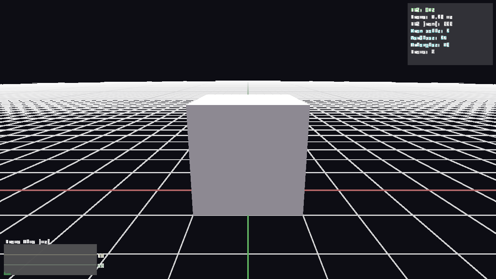
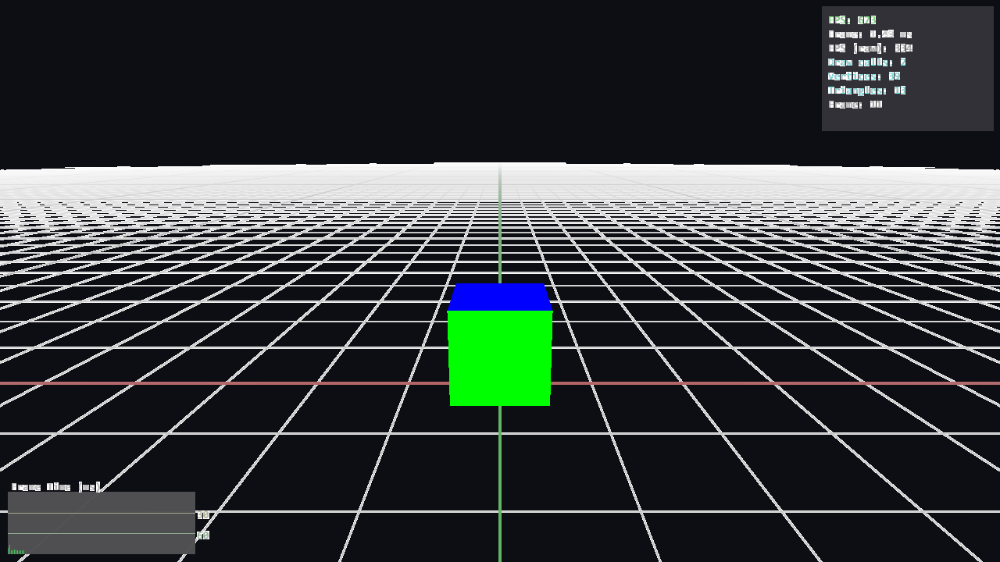
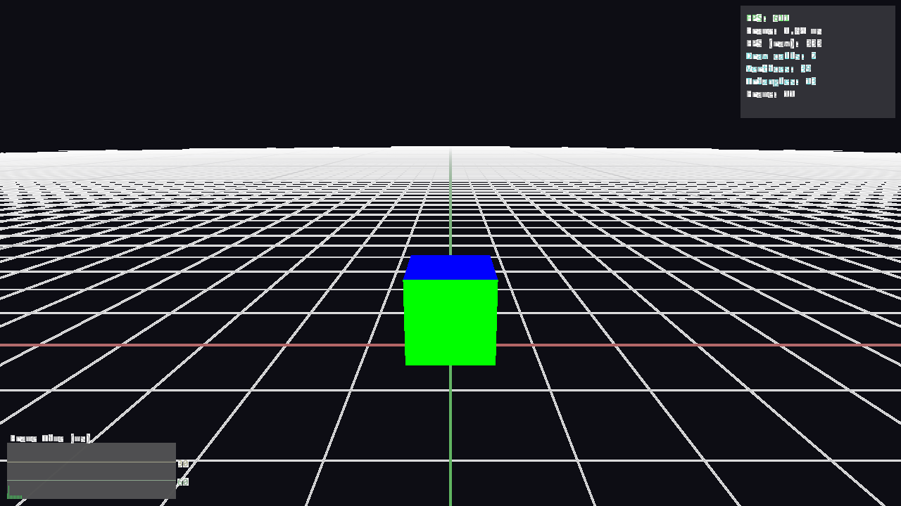

# UzEngine Demo Benchmark Report

**Date**: 2026-03-12
**GPU**: RTX 4090
**Resolution**: 1280x720

## Results

| Demo | Backend | FPS | Status | Screenshot |
|------|---------|-----|--------|------------|
| clear_screen | dx12 | 591 | OK |  |
| clear_screen | dx11 | 828 | OK |  |
| clear_screen | vulkan | 810 | OK |  |
| triangle | dx12 | — | OK |  |
| triangle | dx11 | 972 | OK |  |
| triangle | vulkan | 900 | OK |  |
| textured_quad | dx12 | 174 | OK |  |
| textured_quad | dx11 | 842 | OK |  |
| textured_quad | vulkan | 826 | OK |  |
| mesh_test | dx12 | 256 | OK |  |
| mesh_test | dx11 | 252 | OK |  |
| mesh_test | vulkan | 260 | OK |  |
| camera_test | dx12 | 259 | OK |  |
| camera_test | dx11 | 250 | OK |  |
| camera_test | vulkan | 261 | OK |  |

## Notes

- All demos run with `--frames 500 --screenshot-frame 10`
- Screenshots captured at frame 10
- textured_quad DX12 may show WARN due to intermittent DEVICE_REMOVED (pre-existing issue)
